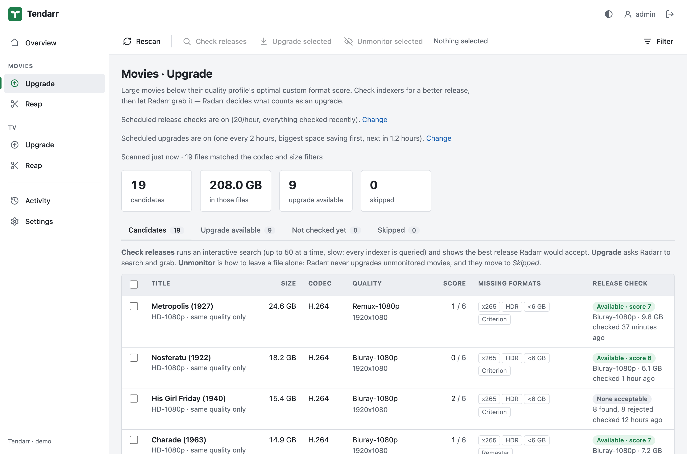
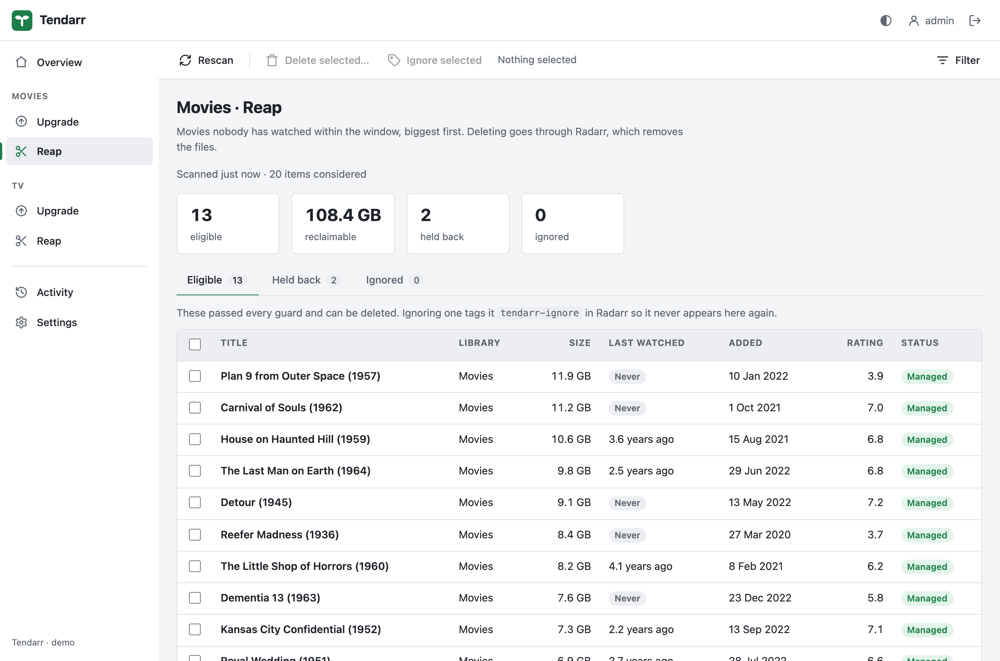
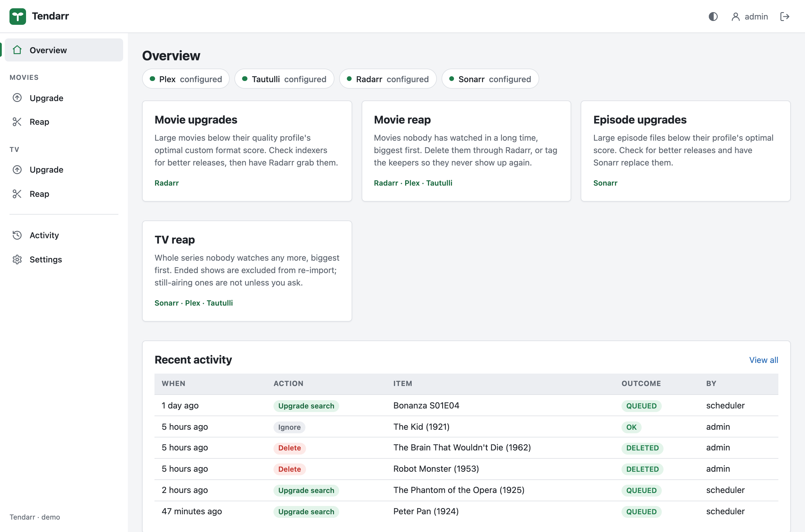

<p align="center">
  <picture>
    <source media="(prefers-color-scheme: dark)" srcset="assets/logo-dark.svg">
    
  </picture>
</p>

<p align="center">
  <strong>Better files, less clutter: a gardener for your Plex library.</strong><br>
  Tendarr finds the movies and episodes worth upgrading, and the ones nobody watches,<br>
  then hands the actual work to Radarr and Sonarr.
</p>

<p align="center">
  <a href="https://github.com/seanhamlin/tendarr/actions/workflows/ci.yml"></a>
  <a href="https://github.com/seanhamlin/tendarr/pkgs/container/tendarr"></a>
  <a href="LICENSE"></a>
</p>

<picture>
  <source media="(prefers-color-scheme: dark)" srcset="assets/screenshots/upgrade-dark.png">
  
</picture>

## Why Tendarr

A library that has grown for years is full of big old x264 rips that a better,
smaller release could replace, and of films nobody has opened since the day they
were added. Radarr and Sonarr will happily upgrade and delete, but they will not
tell you *which* files are worth the trouble. Tendarr does.

- **Upgrade what matters.** Lists large files below their quality profile's custom
  format score, checks your indexers for a release Radarr/Sonarr would actually
  accept, and shows how much space each upgrade saves.
- **Reap what nobody watches.** Finds movies and whole series unwatched for years,
  using Plex *and* Tautulli history so other household members' favourites are
  never mistaken for clutter.
- **Your *arr apps stay in charge.** Tendarr never downloads, imports or deletes
  files itself. It asks Radarr and Sonarr, using your quality profiles, indexers and
  download clients.
- **Safe by default.** Well-rated films are protected, every delete is checked
  twice and confirmed, and anything that cannot be proven to be the right file is
  never offered for deletion.
- **Hands-off when you want it.** Optional scheduled release checks and scheduled
  upgrades work through the backlog at a pace your indexers will tolerate.
- **Tiny and self-contained.** One Go binary with an embedded SQLite database, in a
  multi-arch (amd64 and arm64) distroless image. Runs happily on a Synology NAS.

## Features

### Upgrade

For movies (Radarr) and individual episodes (Sonarr). Pick the codecs worth
replacing (x264 and Xvid by default) and a minimum size, and Tendarr lists every
file that Radarr/Sonarr could act on, with its custom format score and the formats
it is missing.

**Check releases** runs an interactive search and records the best release the
*arr would grab, so you see what an upgrade would bring before asking for it.
**Upgrade selected** then sends the search to Radarr/Sonarr, which grabs and imports
as usual.

### Reap

<picture>
  <source media="(prefers-color-scheme: dark)" srcset="assets/screenshots/reap-dark.png">
  
</picture>

Movies and whole TV series nobody has watched in a long time (two years by
default), biggest first. Delete them through Radarr/Sonarr from a confirmation page,
or **Ignore** the keepers so they never show up again.

### Scheduled checks and upgrades

Turn on **scheduled release checks** and Tendarr checks your backlog in the
background, spreading the searches evenly across the hour. Add **scheduled
upgrades** and it grabs the best of what it found, one item at a time, biggest
space saving first (one every 2 hours by default). Both are off until you turn
them on.

### Overview and activity

<picture>
  <source media="(prefers-color-scheme: dark)" srcset="assets/screenshots/overview-dark.png">
  
</picture>

Every delete, upgrade, ignore and monitoring change is recorded with who (or which
schedule) did it, on the **Activity** page and in the container log.

<sub>Screenshots use a demo library of public-domain films and TV.</sub>

## Quick start

```yaml
# compose.yaml
services:
  tendarr:
    image: ghcr.io/seanhamlin/tendarr:latest
    container_name: tendarr
    restart: unless-stopped
    ports:
      - "8484:8484"
    volumes:
      - /volume1/docker/tendarr:/data   # the database lives here
    environment:
      PUID: 1026   # owner of the folder above: `id <user>` shows it
      PGID: 100
      TZ: Europe/London
```

```bash
docker compose up -d
```

Open `http://<host>:8484`, create the administrator account, then connect your
services under **Settings**. [`compose.example.yaml`](compose.example.yaml) has a
fuller example with comments.

On a **Synology NAS**, paste the same file into Container Manager → **Project** →
**Create**, or use the container wizard and add `PUID`/`PGID` under
**Environment**. No `user` setting is needed.

### Environment variables

Everything else is configured in the web UI. None of these are required.

| Variable | Default | Purpose |
|---|---|---|
| `PUID` / `PGID` | `65532` | The user and group to run as. Set them to the owner of the `/data` folder on the host. At startup the container gives `/data` to them, then drops root before doing anything else. If you set `user:` (or `--user`) instead, that user is used as-is and nothing is changed |
| `TZ` | UTC | Timezone for displayed dates |
| `TENDARR_LISTEN_ADDR` | `:8484` | Listen address |
| `TENDARR_DATA_DIR` | `/data` | Where the SQLite database lives |
| `TENDARR_COOKIE_SECURE` | `auto` | `auto` marks the session cookie `Secure` when the request arrived over HTTPS (directly or via `X-Forwarded-Proto`). Set `true` behind an HTTPS proxy that does not send that header |
| `TENDARR_SESSION_TTL` | `168h` | How long a sign-in lasts without activity |
| `TENDARR_TRUSTED_ORIGINS` | – | Comma-separated extra origins allowed to submit forms, e.g. `https://tendarr.example.com`, for reverse proxies that rewrite `Host` |
| `TENDARR_LOG_LEVEL` | `info` | `debug`, `info`, `warn`, `error` |
| `TENDARR_LOG_FORMAT` | `text` | `text` or `json` |

If `/data` is not writable, the container exits at startup and logs the uid and
gid it is running as.

### Connecting services

| Service | Needed for | Where the key is |
|---|---|---|
| Radarr | Movie upgrade and reap | Settings → General → Security → API Key |
| Sonarr | Episode upgrade and TV reap | Settings → General → Security → API Key |
| Plex | Reap | Open any item in Plex Web → **Get Info** → **View XML**; the token is the `X-Plex-Token` value in the URL |
| Tautulli | Reap (optional, recommended) | Settings → Web Interface → API → API Key |

Every connection is **tested live before it is saved**, so a wrong key, an
unreachable host or the wrong app at that address (Sonarr's URL in the Radarr
field) is caught straight away. Keys are never sent back to the browser.

Tautulli is optional but strongly recommended: Plex only reports watch history for
the account that owns the token, so without Tautulli other users' plays are
invisible.

## How it decides

### Reap

An item is **eligible** only when every guard passes. The guards run twice: once
to build the list, and again immediately before each delete. The server also
refuses to delete anything it cannot see in its own scan, so a stale or tampered
form cannot delete something it should not.

| Guard | Default | Meaning |
|---|---|---|
| Unwatched for | `2y` | Last play (or, if never played, the date added) must be at least this long ago |
| In library for at least | `90d` | Grace period from the date added, so new arrivals are never culled |
| Protect if rated ≥ | `7.5` for movies, off for TV | Rated at or above the floor means protected. **No rating, or fewer votes than the threshold, also means protected**: deleting needs positive evidence a title is bad |
| Min size | off | Skip anything too small to bother with |
| Management | – | Only items Radarr/Sonarr can actually delete, see below |
| Ignored | – | Anything carrying the ignore tag |

The **last watched** date is the later of Plex's and Tautulli's. Neither is
complete on its own: Tautulli only knows plays since it was installed, and Plex
only knows the token owner's.

| State | Meaning | Deletable |
|---|---|---|
| Managed | Matched in Radarr/Sonarr, and confirmed to be the same files | yes |
| Mismatched | Matched, but Radarr/Sonarr manages a **different copy**, typically a separate 4K library matching the 1080p record by IMDb id | no |
| Orphaned | Matched, but Radarr/Sonarr reports no file. Deleting would free nothing and add an import exclusion | no |
| Unmanaged | No Radarr/Sonarr record | no |
| Fuzzy match | Matched on title and year only | only with **Allow title+year matches** |

"Same files" is proven by comparing the Plex library folder with the Radarr/Sonarr
root folder, plus the exact file name for movies. If the apps see your storage
under different paths, add **Path mappings** in Settings
(`/movies:/mnt/media/movies`). Without them it compares the last folder name, which
fails safe: an unproven match is never deletable.

**Ignore selected** adds a tag (default `tendarr-ignore`) to the item in
Radarr/Sonarr; tagging by hand there works too. Ignored items are never offered for
deletion. **Un-ignore** removes the tag.

Deleting adds an **import exclusion** by default, so an import list cannot re-add
the item tomorrow. Still-airing series are the exception, because an exclusion on a
continuing show silently stops its next season; the confirmation page offers it as
a separate, unticked option.

### Upgrade

A file is a **candidate** when it is at least the minimum size, in one of the
selected codecs, and Radarr/Sonarr could actually act on a search:

- the movie or episode (and its series) is **monitored**
- the quality profile **allows upgrades**
- the file is **below the profile's cutoff format score**, or below its quality
  cutoff
- nothing for it is **already downloading**

Anything else goes on **Skipped** with the reason, because the cause is usually a
Radarr/Sonarr setting rather than the file.

**Check releases** searches up to 50 selected items in the background, one at a
time to go easy on indexers. Results are cached and shown with their age; the
**Upgrade available** and **Not checked yet** tabs filter on them.

**Unmonitor selected** is how to leave a file alone: unmonitored items are never
upgraded, by Tendarr or by Radarr/Sonarr's own searches. **Monitor again** on the
Skipped tab reverses it. Tendarr never changes a whole series' monitoring, because
that changes what Sonarr downloads. Unmonitoring has no effect on reap, and reap's
Ignore has no effect on upgrades.

**The quality cutoff catch.** Once a file meets its profile's *quality* cutoff,
Radarr/Sonarr only accepts a custom-format upgrade from a release of the **same
quality**: a WEBDL-1080p file rejects every Bluray-1080p release, however well it
scores. Such rows are marked *same quality only*. To let the score decide, group
the qualities you consider equivalent in the quality profile.

### Schedules

**Scheduled release checks** (Settings, off by default):

- One budget across Radarr and Sonarr, default 20 searches an hour (up to 60),
  spaced evenly rather than in bursts. They usually share indexers, so the combined
  rate is what trackers see.
- Never-checked items first, then the stalest results, largest first, alternating
  between movies and episodes.
- A result is trusted for the re-check window (default 7 days), or until the file
  changes.
- Pauses for a service while you run a manual check against it.
- Only checks; it never grabs.

**Scheduled upgrades** (Settings, off by default):

- Grabs the item whose acceptable release frees the most space, across movies and
  episodes.
- One budget across Radarr and Sonarr, default one every 2 hours (1 to 168). The
  gap survives restarts.
- Only fresh results count: the check must be for the current file and inside the
  re-check window.
- Each upgrade is logged in Activity as user `scheduler`, and the item's result is
  cleared so it is only tried again after a new check finds something.

## Security

- Single administrator account with a bcrypt-hashed password (minimum 12
  characters) and rate-limited sign-in.
- Sessions are random 256-bit tokens, stored only as SHA-256 hashes, in
  `HttpOnly`, `SameSite=Lax` cookies. Changing the password signs out every other
  browser.
- Cross-site form posts are refused, and every form carries a CSRF token.
- Strict Content Security Policy: no inline scripts, no third-party assets.
- Every selection is checked against the server's own scan, never trusted from the
  form.
- API keys live in the SQLite database on the data volume; protect that folder
  like the keys themselves. Tautulli's key, which it only accepts as a query
  parameter, is scrubbed from every error and log line.
- The process runs as an unprivileged user; root is only used at startup to give
  `/data` to `PUID:PGID`.

Tendarr is designed for a home network. To expose it beyond that, put it behind an
HTTPS reverse proxy.

## Compared with Slimarr

[Slimarr](https://github.com/theantipopau/slimarr) shrinks a Plex library by
searching Usenet for smaller releases and replacing files itself via SABnzbd or
NZBGet. Tendarr is the better fit if you:

- want **better files, not just smaller ones**, judged by your Radarr/Sonarr
  quality profiles and custom format scores;
- want Radarr and Sonarr to stay in charge of searching, grabbing and importing,
  with any indexer or download client they support;
- also want to **remove what nobody watches**, using Plex and Tautulli history;
- prefer reviewing changes before they happen, with automation as an option.

## Development

Requires Go (see `go.mod` for the version).

```bash
go test -race ./...             # unit and end-to-end tests, no live services needed
golangci-lint run               # lint, as CI runs it
TENDARR_DATA_DIR=./data TENDARR_LISTEN_ADDR=127.0.0.1:8484 go run ./cmd/tendarr
```

The tests run every flow (setup, sign-in, settings, reap, ignore, delete, upgrade
search, release checks and schedules) against in-process fakes of Plex, Tautulli,
Radarr and Sonarr (`internal/testsvc`), asserting on the exact requests that would
reach the real services.

To explore the UI without a media server, run the demo used for the screenshots.
It serves a public-domain library at `http://127.0.0.1:18490`, user `admin`,
password `demo-password-123`:

```bash
TENDARR_DEMO=1 go test ./internal/demo -run TestDemo -timeout 0
```

| Package | Responsibility |
|---|---|
| `internal/clients/*` | HTTP clients for each service |
| `internal/library` | Joins Plex, Tautulli and Radarr/Sonarr; matching and storage verification |
| `internal/reap` | Guards, planning and deletion |
| `internal/upgrade` | Upgrade eligibility and release evaluation |
| `internal/store` | SQLite: accounts, sessions, settings, release checks, audit log |
| `internal/app` | Service layer: caching, actions, audit, background jobs and schedules |
| `internal/web` | Handlers, templates, auth |

[CI](.github/workflows/ci.yml) runs the tests with the race detector,
`golangci-lint` and `govulncheck` on every push and pull request, then builds the
image and smoke-tests it (including `PUID`/`PGID`) before pushing to GHCR: `main`
from the `main` branch, and the tag name plus `latest` from git tags.
[Dependabot](.github/dependabot.yml) keeps Go modules, Actions and base images
current.

## Licence

[MIT](LICENSE)
